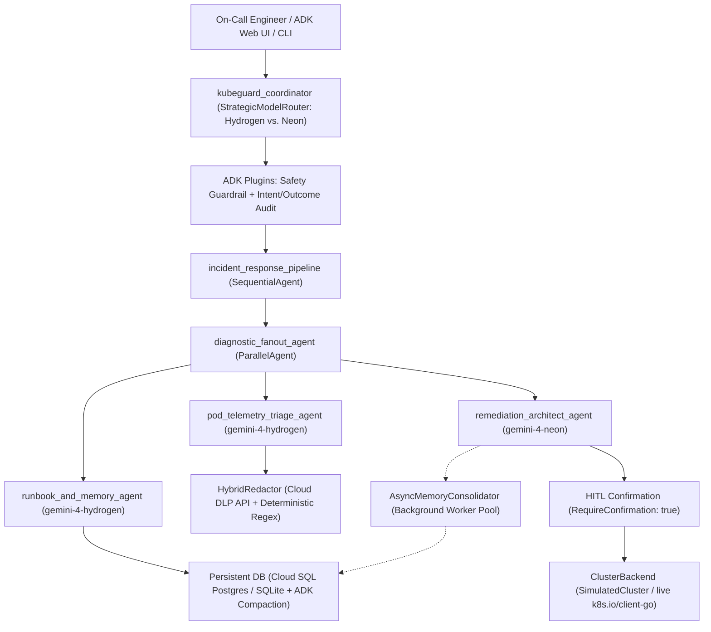

# KubeGuard — Autonomous Kubernetes Incident Triage & Safe Remediation Agent (`adk-go` v2)

**KubeGuard** is a production-grade Enterprise SRE Multi-Agent system built on the **[Google Agent Development Kit (ADK) for Go v2](https://github.com/google/adk-go)** (`google.golang.org/adk/v2`). It automates Kubernetes incident triage—correlating pod crash logs, ReplicaSet rollout diffs, SRE runbooks, and historical postmortems in parallel—while enforcing **Cloud DLP PII redaction**, **Cluster Safety Guardrails**, and **Human-in-the-Loop (HITL) operator confirmation** before executing rollbacks or horizontal scaling.

---

## Problem & Solution

* **Problem:** During production Kubernetes incidents (`OOMKilled` exit `137`, `CrashLoopBackOff` bad rollouts, flash-sale CPU saturation), on-call platform engineers spend critical MTTR stitching together `kubectl logs`, ReplicaSet revisions, and runbooks—while raw crash logs routinely leak customer emails, JWTs, or bearer tokens into observability stores, and blind automated `kubectl` mutations risk outages.
* **Solution:** KubeGuard pairs **low-latency parallel diagnostics (`gemini-4-hydrogen` / `gemini-3.8-flash`)** with **frontier architectural root-cause synthesis (`gemini-4-neon`)**, automatically scrubs PII/secrets via **Google Cloud Sensitive Data Protection (DLP)**, blocks unsafe mutations (`kube-system` or zero-replica scaling) via ADK policy plugins, pauses high-stakes actions for **explicit human approval**, and consolidates postmortem lessons asynchronously into a persistent database.

---

## Multi-Agent Architecture



---

## Quickstart & Google Agents CLI (`agents-cli`) Workflow

### Scaffolding & Lifecycle with `google-agents-cli` (`agent-starter-pack`)

KubeGuard follows the standard **[Google Agents CLI / Agent Starter Pack](https://github.com/GoogleCloudPlatform/agent-starter-pack)** workflow for `adk_go` microservices:

```bash
# Scaffold or upgrade an ADK Go v2 service template with Agents CLI
uvx --from google-agents-cli agents-cli create kubeguard --agent adk_go -d cloud_run

# Install dependencies & launch the local ADK playground / web UI
agents-cli install
agents-cli playground

# Provision cloud infrastructure or deploy to Cloud Run via Agents CLI
agents-cli deploy
```

### Running Locally with `go run`

KubeGuard ships with a **dual-mode `ClusterBackend`**:
1. **`simulated` (default):** Pre-loaded with realistic Kubernetes incidents (`payments/checkout-api` `OOMKilled` with synthetic PII/JWT leaks in crash logs, `catalog/inventory-sync` `CrashLoopBackOff` bad env config, `orders/fulfillment-worker` flash-sale CPU throttling, and protected `kube-system/coredns`) so you can evaluate and demo immediately with zero cluster setup.
2. **`live` (`KUBEGUARD_CLUSTER_MODE=live`):** Connects to any GKE or `kind` cluster via `k8s.io/client-go` (`KUBECONFIG` or in-cluster service account).

```bash
cp .env.example .env
# Option A: Google AI Studio API Key (auto-loaded from .env or shell env)
export GOOGLE_API_KEY="your-gemini-api-key"

# Option B: Vertex AI via Application Default Credentials (no API key required)
# export GOOGLE_CLOUD_PROJECT="your-gcp-project-id"

# Note: In local development, if neither GOOGLE_API_KEY nor GOOGLE_CLOUD_PROJECT is set,
# KubeGuard automatically boots with its built-in Offline Demo SRE Simulator so you can
# explore the ADK Web UI, Agent Graph, HITL approvals, and OTel traces immediately!

# 1. Interactive CLI Console
go run ./cmd/kubeguard console

# 2. ADK Web UI + REST API + A2A Server (bound to 127.0.0.1:8080 by default in dev)
go run ./cmd/kubeguard web webui api a2a
```

Try these prompts in `console` or `webui`:
* *"Which Kubernetes namespaces are currently monitored?"* (Routes to **Gemini Flash** fast tier)
* *"Incident alert: `payments/checkout-api` is in CrashLoopBackOff with OOMKilled errors. Triage root cause and roll back to the last healthy revision."* (Delegates to `incident_response_pipeline`, scrubs leaked PII/JWTs, pauses for **HITL confirmation**, and rolls back from revision `4` to `3` upon approval)
* *"Roll back `kube-system/coredns` to revision 1."* (Deterministically blocked by `ClusterSafetyPolicyPlugin`)

---

## Automated Evaluation & Testing Suite

Run unit tests, security middleware checks, and the **5-scenario Golden Incident Evaluation Suite** (`eval/golden_incidents.json`):

```bash
go vet ./...
go test -race -v ./...
```

The evaluation harness (`eval/evaluator_test.go`) tests the full ADK v2 `Runner`, `SequentialAgent` + `ParallelAgent` fan-out, strategic Flash/Pro routing counters, `toolconfirmation` HITL pause-and-resume lifecycle, `kube-system` policy blocks, prompt-injection refusal, zero PII leakage across transcripts and JSON logs, OpenTelemetry span export, and async background memory consolidation.

---

## Infrastructure as Code (Terraform) & Secret Management

All production Google Cloud resources are codified in `deployment/terraform/`:
* **Cloud Run v2** running the distroless non-root container (`gcr.io/distroless/static-debian12:nonroot`).
* **Google Cloud Secret Manager** storing `kubeguard-gemini-api-key`, `kubeguard-api-auth-token`, and `kubeguard-database-dsn`—injected at runtime via `internal/config/secrets.go` with fail-closed startup semantics and zero hardcoded credentials.
* **Cloud SQL for PostgreSQL 16** (`ENCRYPTED_ONLY` TLS + PITR backups) backing `adk/v2/session/database` and `PersistentKnowledgeStore`.
* **Cloud Sensitive Data Protection (DLP)** & **Cloud Trace** enabled with least-privilege per-secret IAM bindings (`deployment/terraform/iam.tf`).

```bash
cd deployment/terraform
cp terraform.tfvars.example terraform.tfvars
terraform init
terraform plan
terraform apply
```

---

## AgentOps Code Review Matrix Coverage

| Category | Criteria | Implementation in Repository |
| :--- | :--- | :--- |
| **1. Tool & Interface Design** | Comprehensive Tool Docstrings | `internal/tools/diagnostics.go`, `runbooks.go`, `remediation.go` |
| | Descriptive Naming | `fetch_crashing_pod_logs`, `inspect_deployment_rollout_history`, `search_sre_runbooks`, `execute_deployment_rollback`, `scale_deployment_replicas` |
| | Explicit JSON Schemas | `internal/tools/schemas.go` (`jsonschema.For[T]()` + struct schema tags) |
| | Guided Error Handling | `internal/tools/errors.go` (`GuidedRecoveryInfo` with LLM recovery steps) |
| **2. Context & Memory** | Robust System Instructions | `internal/agents/prompts/*.md` + `internal/agents/prompts.go` constitutions |
| | History Compaction | `internal/memory/session_store.go` (`adk/v2/session/compaction` sliding window + token threshold) |
| | Persistent Session State | `internal/memory/session_store.go` & `persistent_memory.go` (`adk/v2/session/database` GORM Postgres/SQLite) |
| | Async Memory Operations | `internal/memory/async_consolidator.go` (non-blocking goroutine pool via `AfterRunCallback`) |
| **3. Orchestration & Logic** | Multi-Agent Patterns | `internal/agents/topology.go` (`Coordinator` -> `SequentialAgent` -> `ParallelAgent` -> `Architect`) |
| | Strategic Model Routing | `internal/agents/router.go` (`StrategicModelRouter` dispatching `gemini-4-hydrogen` vs `gemini-4-neon` with automatic timeout & tier fallback) |
| | Guardrails & Policy Plugins | `internal/guardrails/policy_plugin.go` (`BeforeModel`, `BeforeTool` protected-namespace & replica guardrails, `AfterModel` self-eval) |
| | Human-in-the-Loop Hooks | `internal/tools/remediation.go` (`RequireConfirmation: true` + `adk/v2/tool/toolconfirmation`) |
| **4. Observability & Tracing** | Structured JSON Logging | `internal/observability/logging.go` (Cloud Logging JSON `slog` + trace correlation) |
| | Intent vs. Outcome Capture | `internal/observability/audit_plugin.go` (`BeforeToolCallback` intent + `AfterToolCallback` outcome) |
| | Distributed Tracing | `internal/observability/tracing.go` (`adk/v2/telemetry` + OpenTelemetry SDK spans) |
| | PII Redaction | `internal/privacy/redactor.go` (Google Cloud DLP `apiv2` + deterministic regex scrubber) |
| **5. Infrastructure & CI/CD** | Automated Evaluation Suites | `eval/golden_incidents.json` + `eval/evaluator_test.go` + `.github/workflows/ci.yml` |
| | Infrastructure as Code | `deployment/terraform/*.tf` + `Dockerfile` + `agents-cli` workflow |
| | Secure Secret Management | `internal/config/secrets.go` (`cloud.google.com/go/secretmanager/apiv1`, zero hardcoded secrets) |
